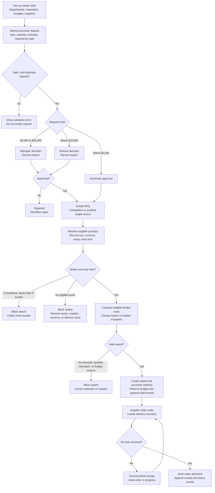

# ProcureFlow: Procurement Workflow & Synthetic Data Engine

[](#10-reproducibility)
[](#8-validation--quality-checks)
[](#2-quickstart)
[](#2-quickstart)

ProcureFlow is a small, runnable procurement workspace backed by a deterministic synthetic-data generator. It follows purchases from request and approval through supplier quotes, awards, purchase orders, and delivery receipts.

The project has two parts:

- **A dataset generator** that creates linked, documented procurement records and keeps evaluation labels separate.
- **A local web app** that lets you exercise the purchasing workflow and inspect its dashboard and audit history.

All generated organizations, people, suppliers, dates, risks, and transactions are synthetic. No external or personal data is used.

---

## 1. What ProcureFlow does

The synthetic workflow models:

1. **Master data:** departments, requesters, budgets, and suppliers.
2. **Purchase requests:** item details, quantities, estimates, and required-by dates.
3. **Approvals:** automatic approval below $5,000; manager approval from $5,000 through $25,000; director approval above $25,000.
4. **Sourcing:** competitive RFQs and documented single-source exceptions.
5. **Quote comparison:** landed cost, supplier status, currency, expiry, and delivery time.
6. **Awards and purchase orders:** split awards are supported; PO lines are created from awarded quotes and funds are reserved in a budget ledger.
7. **Receiving:** deliveries can be partially or fully received, with events recorded as the workflow changes.
8. **Evaluation cases:** known exceptions are labeled in a separate ground-truth export, not added as operational input fields.

The generator is designed for reproducible workflow testing and demonstration; it is not a production procurement or financial system.

### Actual application workflow

The diagram below follows the rules enforced by the running application. A decision or control failure blocks the next step; workflow changes are also recorded in the event history.



In the generated dataset, evaluation-only exceptions are labeled separately in ground truth. Those deliberately injected cases do not mean the interactive application accepts the same policy violations.

---

## 2. Quickstart

Python 3.10 or later is required. The generator and application use only the Python standard library.

Run these commands from the project folder in PowerShell:

```powershell
# Generate the full dataset with the default seed
python .\generate_procurement.py

# Generate a starter dataset (10% scale)
python .\generate_procurement.py --scale starter --output-dir .\starter

# Generate the full dataset and compare the output hashes from two runs
python .\generate_procurement.py --seed 20261022 --scale full --check-reproducibility

# Start the local interactive application
python .\app.py
```

Open [http://127.0.0.1:8000/](http://127.0.0.1:8000/) while the application process is running. The app creates `data\procurement-app.sqlite3` on its first run and reuses it on later runs. To rebuild that local database from the seed, run:

```powershell
python .\app.py --reset
```

To run the tests:

```powershell
python -m unittest discover -s tests -v
```

The generator accepts `--scale starter`, `--scale full`, or a numeric fraction greater than 0 and no greater than 1. Exports go to `output\` by default; change the location with `--output-dir`.

---

## 3. Full dataset volume

With the default seed (`20261022`) and full scale, the validated baseline contains:

| Entity / table | Records | What it represents |
|---|---:|---|
| Departments | 12 | Synthetic operating departments |
| Requesters | 300 | Synthetic requester and approver records |
| Budgets | 12 | Department budgets for the 2026 fiscal year |
| Suppliers | 120 | Synthetic suppliers with status and optional risk flags |
| Purchase requests | 1,200 | Requests with dates, budget references, and status |
| Request lines | 1,200 | Requested items, quantities, and estimated costs |
| Approvals | 1,200 | Approval decisions and recorded reasons |
| RFQs | 500 | 450 competitive events and 50 single-source events |
| Supplier quotes | 1,500 | Offers associated with RFQs and suppliers |
| RFQ awards | 900 | Award allocations, including split awards |
| Purchase orders | 900 | Orders generated from award records |
| Purchase-order lines | 900 | Awarded item quantities and reconciled costs |
| Deliveries | 1,125 | Shipment and receipt records, including partial deliveries |
| Budget ledger | 900 | Purchase-order commitment entries |
| Request events | 2,900 | Request lifecycle history |
| RFQ events | 1,900 | Sourcing lifecycle history |
| Purchase-order events | 1,800 | Order lifecycle history |
| Delivery events | 2,250 | Shipment and receipt history |
| Ground-truth labels | 57 | Evaluation-only known cases |

These are generator output counts. The local app database can have different counts after users create requests or record workflow actions.

---

## 4. IDs and naming

Generated IDs are deterministic and use zero-padded sequence numbers where applicable:

| Record | Example |
|---|---|
| Department | `DEP-001` |
| Requester | `USR-0001` |
| Budget | `BUD-DEP-001-2026` |
| Supplier | `SUP-0001` |
| Purchase request | `PR-2026-000001` |
| Request line | `RL-000001` |
| Approval | `APR-000001` |
| RFQ | `RFQ-2026-000001` |
| Supplier quote | `QUO-S0001-2026-000001` |
| Award | `AWD-000001` |
| Purchase order | `PO-2026-000001` |
| Purchase-order line | `POL-000001` |
| Delivery | `DEL-PO-2026-000001-01` |
| Budget ledger entry | `LED-000001` |

Identifiers are referenced consistently across generated tables. Application-created record numbers continue from the current database contents.

---

## 5. Synthetic exceptions and ground truth

The full baseline contains 57 explicitly labeled cases across eight issue types:

| Issue type | Full-baseline cases | Example |
|---|---:|---|
| Single-source exception | 50 | A single-source RFQ includes a recorded justification. |
| PO issued without approval | 1 | An order is linked to a request with approval still pending. |
| Expired quote before award | 1 | The selected quote is no longer valid at award time. |
| Selected quote not cheapest without rationale | 1 | The selected award lacks a documented non-lowest rationale. |
| Inactive supplier awarded | 1 | An award references an inactive supplier. |
| Budget overrun | 1 | A commitment exceeds the available budget. |
| Duplicate request | 1 | A duplicate is kept with a fresh ID and a rejection record. |
| Quote currency mismatch | 1 | A quote currency differs from the RFQ currency. |

These cases are generated from documented business rules and stored in `output\csv\ground_truth.csv`, `output\json\ground_truth.json`, and `output\sql\ground_truth.sql`. The operational schema and seed SQL do not include the ground-truth table; load the labels separately for evaluation.

The generator also includes boundary coverage such as split awards, supplier risk flags, and partial deliveries. The generator's labeled cases are for evaluation and must not be interpreted as ordinary approved business transactions.

---

## 6. Approval and sourcing rules

### Approval thresholds in the current app

| Request total | Required outcome |
|---|---|
| Below $5,000 | Automatically approved |
| $5,000 through $25,000 inclusive | Manager approval |
| Above $25,000 | Director approval |

### Quote and award rules

- Competitive awards require at least three supplier quotes.
- A single-source RFQ needs a written justification and accepts one supplier quote.
- Expired quotes, inactive suppliers, currency mismatches, and offers that miss the required-by date are not eligible for award.
- The lowest eligible landed-cost offer is preferred. A non-lowest selection requires a written rationale.
- Award quantities can be split among quotes, but must reconcile to the request.
- Awarded quotes create purchase-order lines and budget reservations.
- Delivery receipts update fulfillment status and append event history.

The generated full data has 450 competitive RFQs and 50 single-source RFQs. In the generated dataset, competitive RFQs have three or four quotes; each single-source RFQ has one.

---

## 7. Data relationships

The SQL schema declares primary and foreign keys for the operational records. Principal relationships include:

| Relationship | Cardinality | Meaning |
|---|---|---|
| Department → Requester | 1:N | A department has multiple requesters. |
| Department → Budget | 1:N | Budgets belong to a department. |
| Requester → Purchase request | 1:N | A requester may submit many requests. |
| Budget → Purchase request | 1:N | Requests reserve against a department budget. |
| Purchase request → Request line | 1:N | A request contains one or more requested items. |
| Purchase request → Approval | 1:1 | Each request has an approval record. |
| Purchase request → RFQ | 1:0..1 | Eligible requests may enter sourcing. |
| RFQ → Supplier quote | 1:N | An RFQ may receive one or more supplier offers. |
| RFQ → Award | 1:N | An RFQ can have multiple allocations when split. |
| Award → Purchase order | 1:1 | Each award allocation can create a purchase order. |
| Purchase order → Delivery | 1:N | An order may arrive in multiple shipments. |
| Budget → Budget ledger | 1:N | Commitments are recorded as ledger entries. |

Request, RFQ, purchase-order, and delivery event tables preserve lifecycle history rather than relying only on the current status. Master records also include effective-date fields where applicable.

---

## 8. Validation and quality checks

The full baseline's `output\validation_summary.json` reports `validation_status: passed`. The generator validates:

- Primary-key uniqueness across 18 operational tables and declared unique constraints.
- Foreign-key references, required fields, enums, and numeric values.
- Request-line, supplier-quote, award, purchase-order, and budget-ledger arithmetic.
- Delivery quantities and date ordering.
- Duplicate-request detection and lifecycle event consistency.
- Presence and separation of the required ground-truth labels.

The checked-in full-baseline summary records 31,322 valid foreign-key references, 900 purchase-order reconciliations, 900 award reconciliations, and 2,250 delivery events. Run the generator to rebuild the report from source rather than treating those snapshot numbers as permanent across different scales.

---

## 9. Generated files

Running the generator writes:

- `output\csv\` — table-by-table CSV exports, including the separate ground-truth CSV.
- `output\json\dataset.json` — operational data.
- `output\json\ground_truth.json` — evaluation labels.
- `output\json\data_dictionary.json` and `output\csv\data_dictionary.csv` — field definitions and validation notes.
- `output\sql\schema.sql` — operational SQLite schema.
- `output\sql\seed.sql` — operational seed records.
- `output\sql\ground_truth.sql` — separate evaluation labels.
- `output\validation_summary.json` — validation results and workflow metrics.
- `output\source_manifest.json` — generator version, seed, provenance, row counts, and SHA-256 hashes.

To load the operational SQL into a new SQLite database:

```powershell
sqlite3 .\procurement.db ".read output/sql/schema.sql"
sqlite3 .\procurement.db ".read output/sql/seed.sql"
```

Only load `output\sql\ground_truth.sql` in a separate evaluation database or process.

---

## 10. Reproducibility

The generator uses a fixed seed (`20261022` by default) and stable output formatting. To generate the full dataset twice in memory and compare SHA-256 hashes for every exported file:

```powershell
python .\generate_procurement.py --seed 20261022 --scale full --check-reproducibility
```

The command exits with an error if the two same-seed outputs differ. The full baseline's source manifest includes a hash for each generated export.

---

## 11. Run the browser application

Start the app from the project directory:

```powershell
python .\app.py --port 8000
```

Then open `http://127.0.0.1:8000/`. Keep the server process running while using the workspace. The app provides these views:

- **Overview:** request, approval, sourcing, order, and budget metrics.
- **Requests:** request register, approval decisions, and request intake.
- **Sourcing:** RFQs, quote comparison, and award allocation.
- **Orders & delivery:** purchase orders and receipt recording.
- **Audit trail:** request, sourcing, order, and delivery events.

The app is a local demonstration without sign-in or role-based access control. By default it binds to loopback (`127.0.0.1`); do not expose the editable local app to an untrusted network.

---

## 12. Public read-only demo

The project includes a Railway start command (`Procfile`) and `run_public_demo.py` for a **read-only** hosted demo. The public mode hides editing controls and rejects write requests. It uses synthetic seed data rather than the local SQLite database. Anyone with the public URL can view the demo; do not publish confidential data.

To deploy, create/sign in to a Railway account, then use Railway's CLI from this project directory:

```powershell
railway login
railway init
railway up
railway domain
```

Railway will provide a public domain after deployment. Hosting may incur charges according to the Railway plan. The public deployment is not a production procurement service and has no user accounts or role-based access.

---

## 13. Test suite

Run all generator and application tests with:

```powershell
python -m unittest discover -s tests -v
```

The tests cover deterministic generation, full baseline volumes and anomaly labels, SQL foreign-key integrity, the request-to-delivery workflow, competitive sourcing rules, single-source justification, and the public read-only write guard.

---

## 14. Lawful use and provenance

The dataset is generated synthetically. The source manifest records that no external sources or personal data were used. Names, email addresses, supplier details, risks, dates, and transactions are fictitious and intended only for software testing, demonstrations, and evaluation.
